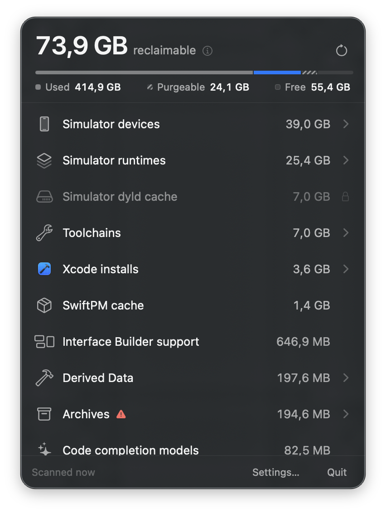
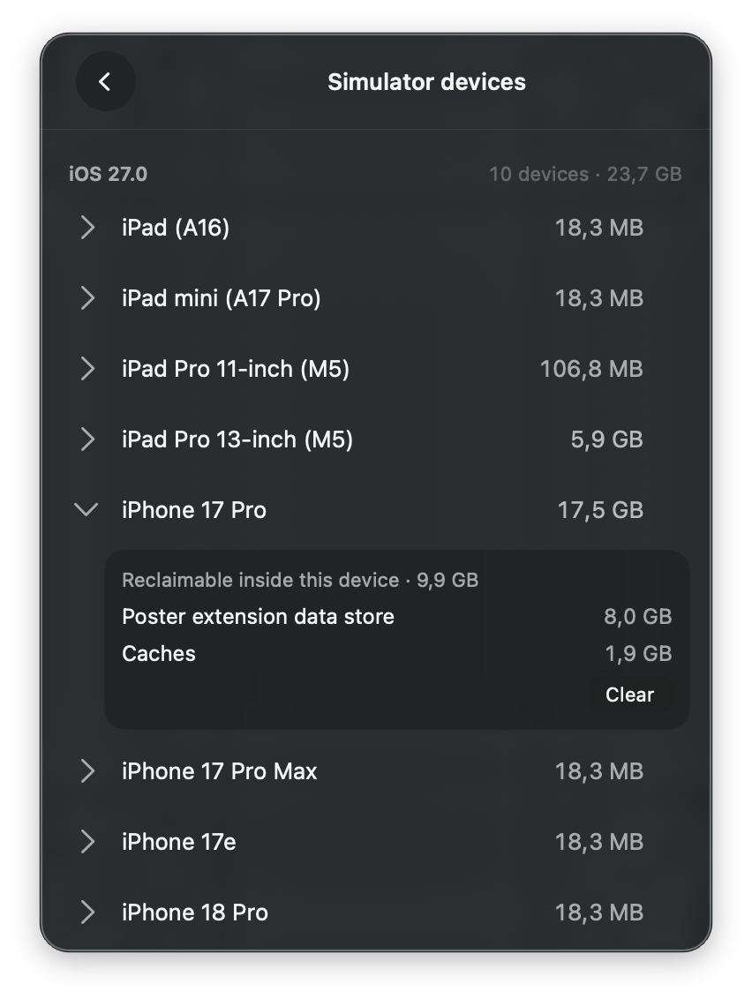
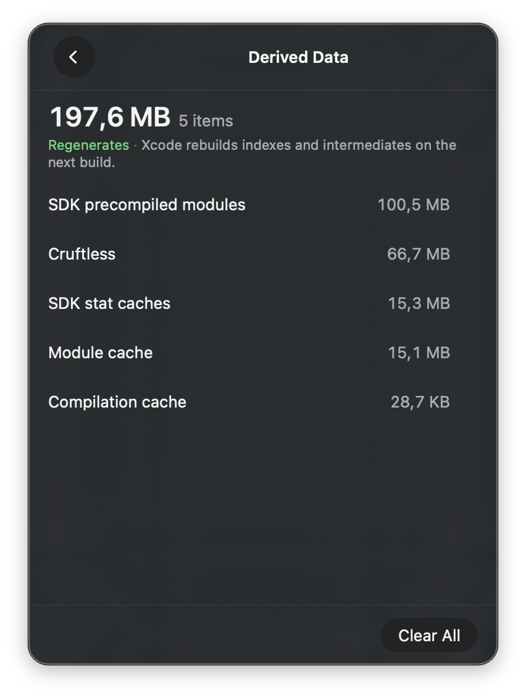

# Cruftless

Cruftless is a native macOS menu bar app that finds the storage used by Xcode,
CoreSimulator, Android Studio, and Gradle, and carefully removes the items you
choose. It shows what can be reclaimed, explains what each deletion costs you,
and asks for confirmation before permanently deleting anything.

<p align="center">
  
  
  
</p>

## Install

With Homebrew:

```bash
brew install --cask danmunoz/tap/cruftless
```

Or download the DMG from
[GitHub Releases](https://github.com/danmunoz/cruftless/releases), open it, and
drag Cruftless to Applications. Settings › About links back to Releases when a
newer version is out, and [CHANGELOG.md](CHANGELOG.md) lists what changed.

Cruftless requires macOS 26 or later. Releases are signed with a Developer ID
and notarized by Apple.

On first launch, a welcome window asks which platforms you develop for, offers
access to any protected folders your setup uses, and runs the first scan.

## Highlights

- Lives in the menu bar and rescans automatically when tracked folders change.
- Breaks usage down by project, simulator, runtime, toolchain, and cache.
- Separates data that tools regenerate from downloads, app data, and files that
  cannot be recovered.
- Opens each location in a detail screen with an explanation of its contents
  and the risk of deleting them.
- Tags Derived Data folders whose project was deleted or moved.
- Shows APFS allocated size, not misleading logical file size, and reports
  purgeable space separately from free space.
- Lets you protect your own folders from deletion.
- Scans Apple development, Android development, or both.
- Runs locally, with no account, analytics, or telemetry.

## What Cruftless scans

| Location | How Cruftless handles it |
|---|---|
| Device Support | Delete; Xcode recreates it when the device reconnects. |
| Simulator devices | Clear known caches, erase a device, or delete it through `simctl`. |
| Xcode test simulators | Delete retained test simulators through `simctl`. |
| Simulator runtimes | Delete through `simctl`, including unusable runtimes. |
| Derived Data | Delete by project or clear the location; Xcode rebuilds it. Folders whose project no longer exists are tagged for review. |
| Previews cache | Delete; Xcode Previews regenerates it. |
| Toolchains | Delete installed toolchains; the active toolchain gets an explicit warning. |
| SwiftPM cache | Delete; packages download again when they resolve. |
| Interface Builder support | Delete; Interface Builder rebuilds it on demand. |
| Archives | Delete one at a time, with a warning: archives hold the dSYMs for shipped builds and cannot be recovered. |
| Build products & logs | Delete build output, logs, and caches; device logs do not regenerate. |
| Xcode installs | Inspect and reveal in Finder; Cruftless does not delete Xcode. |
| Simulator dyld cache | Inspect only; Cruftless gives you a `sudo` command for this root-owned data. |
| Android Studio system files | Inspect recognized cache locations; cleanup is not available. |
| Gradle caches | Remove one eligible entry at a time, after a risk acknowledgement and review. |
| Android SDK | Inspect installed packages; removal is not available. |
| Android Virtual Devices | Delete one stopped device at a time through Google's `android` command-line tool. |

Locations are sorted by reclaimable size, and each one lets you inspect its
items before deciding what to remove.

## Safety model

Cruftless deletes files permanently, because moving them to the Trash frees no
disk space until the Trash is emptied. That makes the deletion boundary the most
important part of the project:

- Nothing is deleted without an explicit action and a review screen. Scanning
  never deletes anything.
- A path guard limits deletion to known development-data folders, resolves
  paths before comparing them, refuses symlinks, and refuses any target that
  contains a protected location.
- Each target's filesystem identity is checked again just before deletion, so
  an item that changed after the scan is refused.
- Simulator devices and runtimes are changed through Apple's `simctl`, never by
  deleting CoreSimulator folders directly.
- Items that cannot be recovered, such as Archives, are flagged, explained, and
  left out of every whole-location or batch action.
- A batch reports the result of every item instead of stopping at the first
  failure.
- Select Items lets you check several entries in one location; the selection
  still goes through Review and confirmation.

You can protect your own folders in **Settings › General**. A deletion that
contains a protected folder is refused as a whole rather than quietly skipping
part of what you asked for.

### Android

- Android SDK packages and Android Studio system files are inventory only.
- An Android Virtual Device can be deleted only while it is stopped and not in
  use, through Google's `android` command-line tool and the normal review step.
  Cruftless checks for the tools when you choose Delete Device and asks before
  installing them. If something launches the device after the final check,
  Cruftless cannot stop it; an incomplete removal is reported and the remaining
  storage stays visible.
- Gradle caches are shared across projects, so each removal needs its own risk
  acknowledgement. Cruftless cannot verify that Gradle has stopped using those
  files: a running build may be interrupted, and offline builds may fail.

## Privacy

Inventory and cleanup run on your Mac. Cruftless contacts the network only
when you check for updates (public release metadata from GitHub) or approve
setting up Android tools (official downloads from Google).

macOS asks for permission before an app reads Documents, Desktop, Downloads,
iCloud Drive, or removable and network volumes. Cruftless never reads one of
those places unless you allow it, in the welcome window or in
**Settings › Access**. Until then, an affected location shows that it needs
access instead of a size.

**Settings › Support** can prepare a diagnostic report for you to review. It
holds only version, toolchain, and Android SDK status fields; paths, usernames,
host details, logs, and inventories are left out. The report is copied or saved
only when you choose to, it is never sent automatically, and the issue tracker
link does not include it.

## About the numbers

Cruftless measures allocated disk usage, including filesystem metadata, and
counts hardlinked files once per volume and inode. Blocks shared between APFS
clones are still counted in full, so totals that involve clones are an upper
bound. Purgeable space is shown separately because macOS already counts it as
free.

## Uninstall

- **Homebrew:** `brew uninstall --zap --cask cruftless` removes the app, its
  data and settings, its login item, its scan reminders, and the privacy
  permissions macOS recorded for it. If your copy predates uninstall support,
  run `brew upgrade cruftless` first, because Homebrew zaps with the cask it
  installed.
- **DMG:** Settings › Support › Remove Cruftless Data shows what it will delete,
  removes it, and quits. Then drag Cruftless to the Trash.
- **By hand**, for a copy already deleted: turn off Launch at login in System
  Settings › General › Login Items, then delete
  `~/Library/Application Support/Cruftless`,
  `~/Library/Caches/com.danmunoz.Cruftless`,
  `~/Library/HTTPStorages/com.danmunoz.Cruftless`,
  `~/Library/Preferences/com.danmunoz.Cruftless.plist`, and
  `$(getconf DARWIN_USER_CACHE_DIR)com.danmunoz.Cruftless`.

Uninstalling does not bring back anything Cruftless deleted, and it does not
touch the developer data Cruftless tracks. macOS may write an empty
`com.danmunoz.Cruftless.plist` back a few seconds after it is removed; it holds
no settings.

## Build from source

You need macOS 26 or later and Xcode 26 with Swift 6.4 or later.

```bash
git clone https://github.com/danmunoz/cruftless.git
cd cruftless
make run
```

`make run` builds the `Cruftless` scheme and opens the app, which appears in
the menu bar.

## Development

Filesystem and deletion logic live apart from the UI:

| Path | Purpose |
|---|---|
| `CruftlessCore/` | Swift package for scanning, inventory, planning, deletion, and naming. |
| `Cruftless/` | SwiftUI menu bar app, welcome window, and Settings. |
| `scripts/` | Maintainer tools: device-table generation and release scripts. |

`make` runs the full validation suite, or run each step on its own:

```bash
make lint   # swiftlint --strict
make test   # swift test --package-path CruftlessCore
make build  # xcodebuild for the Cruftless scheme
```

`make fmt` formats the code with SwiftFormat. Maintainers cutting a release
follow [RELEASING.md](RELEASING.md).

## Contributing

Cruftless is a small, independent project, and thoughtful contributions are
very welcome. If you find a bug, have an idea, or know about a development
folder the app is missing, please open an issue and tell me about it. Pull
requests are welcome too.

Because Cruftless permanently deletes files, I am deliberately conservative
about changes to its deletion logic. For anything substantial, please start
with an issue so we can agree on the behavior and safety boundary first.
Deletion-path changes need focused tests, and every new tracked location must
prove that paths outside its allowed root are rejected. Filesystem work belongs
in `CruftlessCore`, and bug fixes should include a regression test whenever
practical.

## Contact

Hi, I’m [Daniel](https://www.danmunoz.com), the indie developer behind
Cruftless. I’m based in Berlin and always happy to hear from people using the
app. If you have a question, found something odd, or just want to say hello,
you can reach me here:

- **Mastodon:** [@danmunoz@mastodon.social](https://mastodon.social/@danmunoz)
- **Twitter:** [@Makias](https://twitter.com/Makias)
- **Website:** [danmunoz.com](https://www.danmunoz.com)

For bugs and feature ideas, I’d prefer a
[GitHub issue](https://github.com/danmunoz/cruftless/issues) so the conversation
can help other people too.

## Acknowledgements

These projects shaped Cruftless's approach. Only ideas were adopted; no code is
shared.

- [XCleanup](https://github.com/DevEverton/XCleanup) (MIT): a root allowlist for
  deletion, reading `device.plist` to enumerate simulators with `simctl` only
  for changes, and a core library separate from the app.
- [cleardisk](https://github.com/bysiber/cleardisk) (MIT): hardlink and APFS
  clone deduplication, purgeable space reporting, and FSEvents-driven rescans.
- [plonge](https://github.com/mattt/plonge) (MIT): finding orphaned Derived Data
  from each folder's recorded workspace path.
- [DevCleaner for Xcode](https://github.com/vashpan/xcode-dev-cleaner) (GPL-3):
  human-readable device and build names.

The device-identifier table is generated from local CoreSimulator device
profiles plus a baseline of historical models from
[DeviceKit](https://github.com/devicekit/DeviceKit) (MIT).

## License

Cruftless is available under the MIT License. See [LICENSE](LICENSE).
